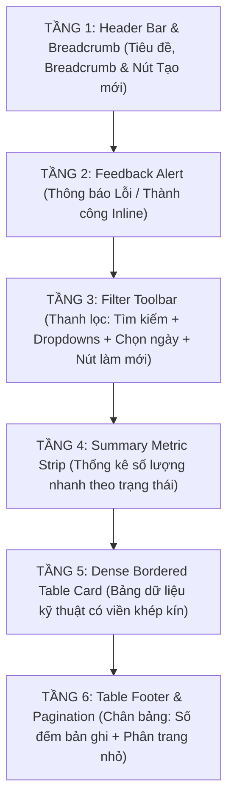

# TIÊU CHUẨN THIẾT KẾ & PHÁT TRIỂN BẢNG DỮ LIỆU VẬN HÀNH (EVN TABLE STANDARD)

> **Phiên bản:** 1.0  
> **Áp dụng cho:** Hệ thống Quản trị & Vận hành UAV Giám sát Lưới điện (UAV-PMS Frontend)  
> **Màn hình chuẩn tham chiếu:** [Đánh giá tiền bay (MF01)](file:///e:/UavPms_FE/UavPms_FE/src/app/features/pre-mission/pages/assessment-list/assessment-list.html) (`/pre-mission`, component `AssessmentList`)

---

## 1. Mục đích & Nguyên tắc cốt lõi

Tài liệu này xác lập **Quy chuẩn Bắt buộc (Mandatory Standard)** cho tất cả các màn hình hiển thị danh sách dạng bảng trong hệ thống UAV-PMS (bao gồm: *Nhiệm vụ bay*, *Thiết bị UAV*, *Đánh giá tiền bay*, *Phiếu bảo dưỡng & Sửa chữa*, *Khuyết tật & Giám định AI*, *Cảnh báo khẩn cấp*, v.v.).

### 3 Nguyên tắc thiết kế EVN Enterprise
1. **Mật độ thông tin cao (High Density / Compact Grid):** Tối ưu không gian hiển thị cho kỹ sư và điều độ viên, không dùng khoảng đệm (padding/margin) thừa thãi.
2. **Ngôn ngữ màu sắc EVN Blue đặc thù:** Màu xanh biển thương hiệu EVN (`#1d4f91` / `#003f99`) làm chủ đạo, kết hợp nền công cụ xanh dịu mắt (`#e6f2fb`), header bảng xanh nhạt (`#d9edf9`), viền kỹ thuật sắc nét (`#9fc3e4`, `#8fb9df`).
3. **Phân cấp thị giác & Trạng thái nghiêm ngặt:** Mỗi cột dữ liệu phải tuân thủ đúng quy chuẩn định dạng (Mã hồ sơ monospace, thời gian chuẩn ISO/VN, nhãn đánh giá 5 tone màu chuẩn, nút thao tác đồng kích thước).

---

## 2. Kiến trúc 6 tầng của Màn hình Dạng Bảng

Tất cả các trang danh sách dạng bảng **bắt buộc** phải tổ chức theo đúng thứ tự 6 tầng sau:



---

## 3. Quy chuẩn Chi tiết từng Tầng

### Tầng 1: Header Bar & Breadcrumb (`.pre-mission-head` hoặc `.table-head`)

* **Breadcrumb (`.pre-mission-breadcrumb`):**
  - Font size: `11px`, font-weight `700`, chữ in hoa (`text-transform: uppercase`), `letter-spacing: 0.05em`.
  - Màu chữ dẫn: `#64748b`, dấu phân cách `/` màu `#94a3b8`, tên phân hệ hiện tại `strong` màu `#10387d`.
* **Tiêu đề chính (`h1`):**
  - Font size: `22px`, font-weight `700`, màu `#0f2952`, line-height `1.25`, margin `4px 0 4px 0`.
* **Mô tả ngắn (`p`):**
  - Font size: `13px`, font-weight `400`, màu `#526b82`, line-height `1.4`.
* **Nút hành động chính (`.evn-btn.primary`):**
  - Căn sát mép phải màn hình (`align-items: flex-end`).
  - Nền `#1d4f91`, viền `#163f75`, chữ trắng, chiều cao `28px`, font-size `11px`, font-weight `700`, bo góc nhẹ `2px`.
  - Icon bên trái chữ (ví dụ: `nz-icon nzType="plus"`).

```html
<header class="pre-mission-head">
  <div>
    <div class="pre-mission-breadcrumb">
      <span>TIỀN NHIỆM VỤ</span>
      <span class="separator">/</span>
      <strong>ĐÁNH GIÁ TÍNH KHẢ THI & MỨC SẴN SÀNG (MF01)</strong>
    </div>
    <h1>Danh sách đánh giá tiền nhiệm vụ</h1>
    <p>Đánh giá phạm vi, tính khả thi mặt bằng, nhân sự và UAV trước khi tạo nhiệm vụ bay</p>
  </div>
  @if (canManage()) {
    <div class="head-actions">
      <a class="evn-btn primary" routerLink="/pre-mission/new">
        <span nz-icon nzType="plus" aria-hidden="true"></span>Tạo đánh giá mới
      </a>
    </div>
  }
</header>
```

---

### Tầng 2: Alert Feedback (`.evn-alert`)

Hiển thị thông báo phản hồi thao tác ngay bên dưới header, không che khuất bảng:
* **Alert lỗi:** Nền `#fee2e2`, viền `#fca5a5`, chữ `#991b1b`, font-size `11px`, có nút đóng `button`.
* **Alert thành công:** Nền `#f0fdf4`, viền `#86efac`, chữ `#166534`, font-size `11px`, có nút đóng `button`.

---

### Tầng 3: Filter Toolbar (`.pre-mission-filters`)

Thanh công cụ lọc nghiệp vụ dính liền bên trên bảng:
* **Màu nền:** `#e6f2fb` (Xanh nhạt EVN Classic).
* **Viền:** `1px solid #9fc3e4`, bo góc `0` (dính liền viền bảng bên dưới).
* **Chiều cao & Padding:** Min-height `36px`, padding `4px 8px`, `gap: 8px`, `display: flex; flex-wrap: wrap; align-items: center;`.
* **Ô tìm kiếm (`.search-input-wrap`):**
  - Có icon kính lúp (`nzType="search"`) cố định bên trái (left: `6px`, màu `#64748b`).
  - Chiều rộng `240px`, chiều cao `26px`, padding `2px 8px 2px 24px`, viền `1px solid #9fc3e4`, bo góc `2px`, font-size `11px`.
* **Các bộ chọn (`select`, `input[type="date"]`):**
  - Nhãn đi kèm (`label > span`): Font-size `11px`, font-weight `600`, màu `#174f83`.
  - Control: Chiều cao `26px`, viền `1px solid #9fc3e4`, font-size `11px`.
* **Nút bấm:**
  - Nút **"Làm mới"** (`.evn-btn.secondary`): Chiều cao `26px`, nền `#ffffff`, viền `#9fc3e4`, chữ `#174f83`, icon `reload`.
  - Nút **"Đặt lại"**: Chỉ xuất hiện khi có bất kỳ điều kiện lọc nào đang hoạt động.

---

### Tầng 4: Summary Metric Strip (`.pre-mission-summary-strip`)

Thanh thống kê nhanh số lượng hồ sơ theo từng phân loại:
* **Vị trí:** Đặt ngay dưới Filter Toolbar, `border: 1px solid #9fc3e4; border-top: 0;`.
* **Màu nền:** `#f8fbfe`, chữ màu `#244e82`, font-size `11px`.
* **Chiều cao:** Min-height `28px`, padding `5px 12px`.
* **Căn chỉnh:** `display: flex; justify-content: flex-end; gap: 16px;`.
* **Định dạng dữ liệu:**
  - Số lượng: Thẻ `<strong>`, màu `#003f99`, font-weight `700`.
  - Tên chỉ số: Thẻ `<span>`, màu `#244e82`.

Ví dụ hiển thị:
```
3 Tổng số đánh giá    0 Sẵn sàng    0 Chưa sẵn sàng    3 Hết hạn / Hoàn thành / Hủy
```

> [!IMPORTANT]
> **Quy tắc ngôn ngữ 100% Tiếng Việt:** Toàn bộ giao diện người dùng, nhãn bộ lọc, thông báo và trạng thái thực thể phải dùng hoàn toàn tiếng Việt thuần túy. Tuyệt đối không mở ngoặc đơn chú thích mã tiếng Anh (ví dụ: cấm dùng `Sẵn sàng (READY)`, `Chưa sẵn sàng (NOT_READY)`, `Đang đánh giá (EVALUATING)`, `Đã lập nhiệm vụ (COMPLETED)`, v.v. — chỉ hiển thị `Sẵn sàng`, `Chưa sẵn sàng`, `Đang đánh giá`, `Đã lập nhiệm vụ`).

---

### Tầng 5: Dense Bordered Table Card (`.pre-mission-table-card`)

Khối bao bọc bảng dữ liệu chính, đảm bảo cuộn ngang mượt mà khi màn hình hẹp:
* **Viền khối:** `border: 1px solid #8fb9df; border-top: 0; background: #ffffff;`.
* **Vùng cuộn (`.table-scroll`):** `overflow-x: auto; width: 100%;`. Bảng có `min-width` tối thiểu (thường `980px` - `1200px`) để không bị vỡ cột.
* **Cấu trúc bảng (`table`):** `border-collapse: collapse; width: 100%;`.

#### Quy chuẩn Tiêu đề Cột (`th`)
* **Chiều cao:** Cố định `25px`.
* **Padding:** `4px 8px`.
* **Màu nền:** `#d9edf9` (EVN Table Header Light Blue).
* **Đường viền:** `1px solid #9fc3e4`.
* **Kiểu chữ:** Font-size `10px`, font-weight `700`, chữ in hoa (`text-transform: uppercase`), `letter-spacing: 0.03em`, màu `#174f83`.
* **Căn lề:** Mặc định căn giữa (`text-align: center`), ngoại trừ cột mô tả dài thì căn trái.

#### Quy chuẩn Ô dữ liệu (`td`)
* **Chiều cao:** Cố định `27px` (hoặc min-height `27px` cho dòng 2 hàng).
* **Padding:** `4px 8px`.
* **Đường viền:** `1px solid #d6dde4`.
* **Kiểu chữ:** Font-size `11px`, màu `#0f172a`, `vertical-align: middle`.
* **Hiệu ứng Hover:** Khi rê chuột qua dòng: `tbody tr:hover { background: #eef7fd; }`.

#### Quy chuẩn cho từng Loại Cột Dữ Liệu
| Loại cột | Căn lề | Định dạng hiển thị & Class | Chiều rộng chuẩn |
| :--- | :--- | :--- | :--- |
| **Mã đối tượng** | Căn trái | Class `.evn-code`, font monospace, font-size `10px`, màu `#173b70`. Hover gạch chân. | `120px - 140px` |
| **Phạm vi / Tên** | Căn trái | 2 tầng: Dòng 1 `<strong>Tên khu vực</strong>`, Dòng 2 `<span style="color: #64748b;">· 2 cột</span>`. | `180px - 240px` |
| **Khung giờ / Ngày** | Căn trái/giữa | Dải giờ: `dd/MM HH:mm – dd/MM HH:mm` (dùng dấu gạch `–`). Ngày tạo: `dd/MM/yyyy HH:mm`. | `140px - 170px` |
| **Đánh giá thành phần** | Căn giữa | Tag nhỏ `.evn-status` (ĐẠT / K.ĐẠT). | `80px - 95px` |
| **Trạng thái tổng thể**| Căn giữa | Tag `.evn-status` với tone màu theo bảng bên dưới. | `105px - 120px` |
| **Cột Thao tác** | Căn giữa | Cụm nút bấm flex, gap `4px`. | `120px - 150px` |

#### Bảng Tone màu Trạng thái Chuẩn (`.evn-status`)
Các tag trạng thái có kích thước nhỏ gọn: `font-size: 9px`, `font-weight: 700`, `text-transform: uppercase`, `padding: 2px 6px`, bo góc `2px`.

| Tone | Class tương thích | Màu nền | Màu chữ | Màu viền | Ý nghĩa nghiệp vụ |
| :--- | :--- | :--- | :--- | :--- | :--- |
| **Thành công** | `.success`, `.ready`, `.pass`, `.feasible`, `.completed` | `#dcfce7` | `#15803d` | `#86efac` | ĐẠT, SẴN SÀNG, ĐÃ HOÀN THÀNH |
| **Cảnh báo** | `.warning`, `.evaluating` | `#fef3c7` | `#b45309` | `#fde68a` | ĐANG ĐÁNH GIÁ, CHỜ DUYỆT |
| **Nguy cấp / Lỗi**| `.danger`, `.not_ready`, `.fail`, `.expired`, `.cancelled` | `#fee2e2` | `#b91c1c` | `#fca5a5` | KHÔNG ĐẠT, CHƯA SẴN SÀNG, ĐÃ HỦY |
| **Thông tin** | `.info`, `.draft` | `#e0f2fe` | `#0369a1` | `#bae6fd` | DỰ THẢO, TẠO MỚI |
| **Trung tính** | `.neutral`, `.consumed`, `.unknown` | `#f1f5f9` | `#475569` | `#cbd5e1` | ĐÃ DÙNG, CHƯA XÁC ĐỊNH |

#### Cột Thao tác (Action Buttons)
* Đặt trong flexbox: `display: flex; align-items: center; justify-content: center; gap: 4px;`.
* Kích thước nút con: `height: 22px; min-height: 22px; padding: 0 6px; font-size: 10px; border-radius: 2px;`.
* **Nút "Mở":** `.evn-btn.secondary` (Nền trắng, viền `#9fc3e4`, chữ `#174f83`).
* **Nút liên kết quy trình tiếp theo (ví dụ "Nhiệm vụ"):** Nền `#eff6ff`, viền `#bfdbfe`, chữ `#1d4ed8`, kèm icon `send` nhỏ 10px.
* **Nút hành động nhanh (Đánh giá lại, Hủy):** Icon `reload` hoặc `close`, khi busy hiển thị icon `loading`.

---

### Tầng 6: Table Footer & Pagination (`footer`, `.evn-pagination`)

Chân bảng khép kín đáy bảng dữ liệu:
* **Màu nền:** `#dceef9`.
* **Đường viền:** `border-top: 1px solid #9fc3e4`.
* **Chiều cao:** Min-height `32px`, padding `3px 10px`.
* **Bố cục:** `display: flex; justify-content: space-between; align-items: center;`.
* **Bên trái (Bộ đếm bản ghi):**
  - Font-size: `10px`, màu `#174f83`.
  - Cú pháp chuẩn: `Hiển thị [Từ] - [Đến] trong tổng số [Tổng] bản ghi`.
* **Bên phải (Phân trang `.evn-pagination`):**
  - Các nút phân trang: Chiều cao `22px`, min-width `23px`, padding `0 4px`, viền `1px solid #9fc3e4`, bo góc `2px`, nền `#ffffff`, chữ `#174f83`, font-size `10px`, font-weight `600`.
  - Nút trang hiện tại (`.active`): Nền `#1d4f91`, viền `#163f75`, chữ trắng.
  - Nút bị vô hiệu hóa (`:disabled`): `opacity: 0.45; cursor: not-allowed;`.

---

## 4. Modal Xác nhận Nghiệp vụ Chuẩn EVN (`.evn-modal-dialog`)

Mọi thao tác quan trọng hoặc có tính hủy (Hủy đánh giá, Đóng phiếu bảo dưỡng, Xóa hồ sơ) phải dùng modal xác nhận với style ERP truyền thống:
* **Backdrop:** `background: rgba(15, 23, 42, 0.45); z-index: 1050;`.
* **Khung Dialog:** Max-width `490px`, viền kỹ thuật `1px solid #8fb9df`, **bo góc 0 (vuông vức)**, bóng đổ `0 4px 18px rgba(0, 0, 0, 0.22)`.
* **Header Modal (`.evn-modal-header`):** Nền `#e6f2fb`, viền dưới `1px solid #9fc3e4`, tiêu đề in hoa `12px` font-weight `700`, màu `#0f2952`, icon cảnh báo đỏ/vàng `15px`.
* **Thân Modal (`.evn-modal-body`):**
  - Hộp cảnh báo (`.modal-alert-box`): Nền `#fff5f5`, viền `#fecaca`, viền trái `3px solid #dc2626`, chữ `#991b1b`, font `11px`.
  - Hộp thông tin tóm tắt đối tượng: Nền `#f8fafc`, viền `1px solid #e2e8f0`.
  - Trường nhập lý do (`textarea`): Viền `#9fc3e4`, focus viền `#1d4f91`, font `11px`.
* **Footer Modal (`.evn-modal-footer`):** Nền `#f8fbfe`, viền trên `1px solid #9fc3e4`, nút "Giữ lại / Đóng" (Secondary) và nút "Xác nhận hành động" (Danger hoặc Primary) cao `26px`, bo góc `0`.

---

## 5. Quy chuẩn Kỹ thuật Angular & TypeScript (Bắt buộc theo `AGENTS.md`)

Khi hiện thực một bảng danh sách mới, lập trình viên phải tuân thủ nghiêm ngặt các quy tắc sau:

1. **Standalone Component:** Không khai báo `standalone: true` (mặc định trong Angular 20+).
2. **OnPush Change Detection:** Luôn đặt `changeDetection: ChangeDetectionStrategy.OnPush`.
3. **Quản lý trạng thái bằng Signals:**
   - Dùng `signal()` cho: `loading`, `items`, `page`, `pageSize`, `totalCount`, các giá trị bộ lọc (`searchQuery`, `statusFilter`, `regionFilter`, `dateFilter`), modal state (`actionBusyId`, `itemToCancel`).
   - Dùng `computed()` cho: dữ liệu đã lọc (`filteredItems`), thống kê (`stats`), chỉ số phân trang (`startIndex`, `endIndex`, `totalPages`, `pageButtons`), quyền thao tác (`canManage`).
   - **Tuyệt đối không dùng `mutate`**: Luôn dùng `update()` hoặc `set()`.
4. **Native Control Flow trong Template:**
   - Sử dụng `@if`, `@else if`, `@else`, `@for (...; track ...)` và `@empty`.
   - **Cấm tuyệt đối dùng `*ngIf`, `*ngFor`, `*ngSwitch`**.
5. **Class & Style Bindings:**
   - **Cấm tuyệt đối dùng `ngClass`**: Sử dụng `[class.active]="..."`, `[class]="..."` hoặc string interpolation `class="evn-status {{ statusTone(...) }}"`.
   - **Cấm tuyệt đối dùng `ngStyle`**: Sử dụng `[style.width.px]="..."` hoặc style inline thuần.
6. **Xử lý Trạng thái Tải & Trống:**
   - Khi `loading() === true`: Hiển thị 5 dòng skeleton `@for (s of [1,2,3,4,5]; track s)` với thông báo `"Đang tải dữ liệu..."`, kèm `[attr.aria-busy]="loading()"`.
   - Khi `!filteredItems().length`: Hiển thị dòng thông báo `"Chưa có bản ghi nào phù hợp điều kiện lọc."`, `colspan` bằng tổng số cột.
7. **Accessibility (A11y / AXE / WCAG AA):**
   - Đảm bảo các nút icon có `aria-label` hoặc `title`.
   - Bảng phải có cấu trúc `<table>`, `<thead>`, `<tbody>`, `<th>`, `<td>`.
   - Khối bảng có `role="region"` hoặc `aria-label="Danh sách..."`.

---

## 6. Mẫu SCSS Kế thừa Nhanh (Shared Mixin / Import)

Để tái sử dụng toàn bộ kiểu dáng bảng chuẩn này trong các màn hình khác mà không phải viết lại SCSS, hãy import file SCSS dùng chung:

```scss
// Trong component SCSS của trang mới (ví dụ: mission-list.scss, drone-list.scss):
@use 'src/app/features/pre-mission/pages/pre-mission-page' as evnTable;

:host {
  display: block;
  max-width: 100rem;
  margin-inline: auto;
  font-family: 'Be Vietnam Pro', 'Roboto', system-ui, -apple-system, sans-serif;
}
```

Hoặc sử dụng trực tiếp các class chuẩn EVN đã được khai báo toàn cục:
* `.pre-mission-filters` hoặc `.evn-table-filters`
* `.pre-mission-summary-strip` hoặc `.evn-summary-strip`
* `.pre-mission-table-card` hoặc `.evn-table-card`
* `.evn-btn` (`.primary`, `.secondary`, `.success`, `.danger`)
* `.evn-status` (`.success`, `.warning`, `.danger`, `.info`, `.neutral`)
* `.evn-pagination`
* `.evn-modal-backdrop`, `.evn-modal-dialog`

---

## 7. Checklist Kiểm tra Nghiệm thu (Definition of Done cho Bảng mới)

Trước khi bàn giao bất kỳ màn hình danh sách bảng nào, kiểm tra danh mục sau:

- [ ] Header có đầy đủ Breadcrumb chữ hoa nhỏ 11px, Tiêu đề h1 22px, Mô tả 13px, Nút tạo mới (nếu có quyền).
- [ ] Toolbar lọc màu xanh nhạt `#e6f2fb`, dính liền viền trên của bảng, có nút Làm mới và Đặt lại.
- [ ] Có thanh thống kê số liệu nhanh (Summary Strip) căn phải với chữ số in đậm xanh `#003f99`.
- [ ] Header bảng (`th`) cao 25px, nền `#d9edf9`, viền `#9fc3e4`, chữ hoa 10px bold.
- [ ] Hàng dữ liệu (`td`) cao 27px, viền `#d6dde4`, font 11px, hover sáng `#eef7fd`.
- [ ] Mã đối tượng dùng font monospace 10px `#173b70`, có link xem chi tiết.
- [ ] Các tag trạng thái tuân thủ đúng 5 tone màu chuẩn (`.success`, `.warning`, `.danger`, `.info`, `.neutral`).
- [ ] Cột thao tác căn giữa, các nút bấm con cao đúng 22px.
- [ ] Chân bảng nền `#dceef9`, hiển thị đúng bộ đếm bản ghi và cụm nút phân trang 22px.
- [ ] Có trạng thái Skeleton loading và Empty state khi không có dữ liệu.
- [ ] Thao tác hủy/xóa mở đúng Modal chuẩn EVN không bo góc với hộp cảnh báo đỏ.
- [ ] Tuân thủ quy chuẩn Angular: Signals, OnPush, `@if`/`@for`, không `ngClass`/`ngStyle`.

---

## 8. Danh Sách Màn Hình Đã Chuẩn Hóa Theo Tiêu Chuẩn Này

| STT | Màn hình | Tuyến đường (Route) | File Template & Logic | Trạng thái |
|---|---|---|---|:---:|
| 1 | **Đánh giá tiền bay (MF01)** | `/pre-mission` | `src/app/features/pre-mission/pages/assessment-workspace/` | **Chuẩn mực (Gốc)** |
| 2 | **Quản lý cột điện** | `/towers` | `src/app/features/towers/pages/tower-list/` | **Đã chuẩn hóa** |
| 3 | **Quản lý nhiệm vụ bay** | `/missions` | `src/app/features/missions/pages/mission-list/` | **Đã chuẩn hóa** |
| 4 | **Quản lý phương tiện UAV** | `/drones` | `src/app/features/drones/pages/drone-management/` | **Đã chuẩn hóa** |
| 5 | **Duyệt sự cố AI** | `/ai-review` | `src/app/features/analyst-review/pages/detection-list/` | **Đã chuẩn hóa** |
| 6 | **Phiếu bảo trì & Sửa chữa** | `/maintenance` | `src/app/features/maintenance/pages/maintenance-list/` | **Đã chuẩn hóa** |
| 7 | **Lịch sử kiểm tra khuyết tật** | `/inspections` | `src/app/features/monitor/pages/inspection-history/` | **Đã chuẩn hóa** |
| 8 | **Báo cáo & Phân tích vận hành** | `/reports` | `src/app/features/reports/pages/reports-page/` | **Đã chuẩn hóa** |
| 9 | **Quản lý người dùng & Phân quyền** | `/admin/users` | `src/app/features/users/pages/user-management/` | **Đã chuẩn hóa** |


