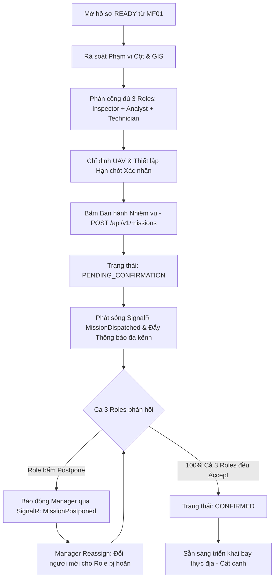

# MF02 v2.0 — FE Specification
## Tạo & Điều phối Nhiệm vụ Bay (Create & Assign Inspection Mission)

---

## 1. Lịch sử Phiên bản (Version History)

| Phiên bản | Thay đổi chính |
|---|---|
| v1.0.x | Tạo nhiệm vụ độc lập, tự chọn lại danh sách cột, chỉ phân công 01 phi công (Inspector). |
| **v2.0** | **Chuẩn hóa toàn diện MF02 theo Mô hình Đa Vai trò & Tuyến tính (Linear Workflow)**:<br>• Kế thừa 100% hồ sơ `READY` từ MF01.<br>• Bắt buộc ma trận phân công đủ **3 vai trò**: Inspector (Phi công), Analyst (Chuyên viên AI), Technician (Kỹ thuật viên bảo trì/drone).<br>• Ràng buộc xác nhận 3 bên: Nhiệm vụ chỉ chuyển sang `CONFIRMED` khi cả 3 roles đều đã bấm `Accept`.<br>• Xử lý hoãn (Postpone) & Tái phân công (Reassign) theo thời gian thực qua SignalR Hub.<br>• Phân định nghiêm ngặt: Mã định danh trên URL API là **GUID** (`mission.id`), mã hiển thị giao diện là chuỗi thân thiện (`mission.missionCode`). |

---

## 2. Mục tiêu Nghiệp vụ của MF02 (Goal)

MF02 chuyển hóa một hồ sơ đánh giá tiền nhiệm vụ (`PreMissionAssessment`) đạt chuẩn `READY` từ MF01 thành một **Nhiệm vụ bay kiểm tra thực địa (`Mission`)** chính thức.

> **Quy tắc cốt lõi: Nạp kế thừa → Rà soát phạm vi → Phân công đủ 3 Roles & UAV → Ban hành → Xác nhận 3 vai trò → Sẵn sàng cất cánh.**

Manager không phải chọn lại từ đầu danh sách cột điện, trạm biến áp hay vùng bản đồ GIS khi hồ sơ MF01 đã thẩm định xong.

---

## 3. Các Vai trò Tham gia (Primary Actors)

- **Mission Manager (Quản lý vận hành)**: Tạo nhiệm vụ, chọn người cho 3 vai trò, gán UAV, thiết lập hạn chót phản hồi (`confirmationDeadline`), điều phối đổi người (Reassign) khi có nhân sự xin hoãn.
- **Inspector / Pilot (Phi công UAV)**: Nhận nhiệm vụ, kiểm tra tọa độ cột, vùng đệm an toàn GIS, kiểm tra UAV được bàn giao, bấm `Accept` tiếp nhận bay hoặc `Postpone` xin hoãn.
- **Analyst (Chuyên viên phân tích AI)**: Nhận nhiệm vụ, kiểm tra danh mục thiết bị, danh sách lỗi cần AI quét, bấm `Accept` tiếp nhận thẩm định hoặc `Postpone`.
- **Technician (Kỹ thuật viên bảo trì/drone)**: Nhận nhiệm vụ, xác nhận biên bản bàn giao drone (`drone-handover`), bấm `Accept` sẵn sàng hỗ trợ kỹ thuật hoặc `Postpone`.
- **Backend & SignalR Realtime Hub (`/hubs/notifications`)**: Đồng bộ sự kiện tức thì tới các tab trình duyệt của cả 3 roles, cập nhật tiến độ ma trận xác nhận (`confirmationProgress`).

---

## 4. Sơ đồ Quy trình Vận hành Tuyến tính (Linear Flow Diagram)



---

## 5. Quy tắc Ràng buộc Bắt buộc: GUID vs Mission Code

> [!WARNING]
> ### QUY TẮC SỐ 1 VỀ PATH PARAMETER: GUID (UUID v4)
> Tất cả các route trong `MissionController.cs` trên Backend ASP.NET Core đều áp dụng ràng buộc `{id:guid}`:
>
> ```csharp
> [HttpGet("{id:guid}")]
> [HttpGet("{id:guid}/assignments")]
> [HttpPost("{id:guid}/assignments/accept")]
> [HttpPost("{id:guid}/assignments/postpone")]
> [HttpPost("{id:guid}/assignments/{assignmentId:guid}/reassign")]
> ```
>
> - ✅ **REQUEST HỢP LỆ**: `GET /api/v1/missions/3fa85f64-5717-4562-b3fc-2c963f66afa6/assignments`
> - ❌ **LỖI 404 ROUTE NOT MATCH**: `GET /api/v1/missions/msn-icrfyl/assignments` *(Do `msn-icrfyl` là chuỗi code/text, bộ định tuyến ASP.NET không match regex GUID dẫn đến trả về HTTP 404 Not Found ngay lập tức).*
>
> **Triển khai chuẩn mực trong Frontend**:
> 1. `mission.id`: Bắt buộc là GUID (UUID v4), được dùng làm tham số truyền trên mọi URL API backend và route Angular (`/missions/:id`).
> 2. `mission.missionCode`: Là chuỗi định danh thân thiện (ví dụ: `MSN-2026-0042` hoặc `MIS-20260617-01`), **chỉ dùng để hiển thị trên giao diện người dùng** (Header, thẻ Badge, tiêu đề thông báo).

---

## 6. Danh mục Endpoints Backend Tương ứng trong Codebase

| Method | Endpoint | Mô tả | File Frontend Xử lý |
|---|---|---|---|
| `POST` | `/api/v1/missions` | Tạo mới và ban hành nhiệm vụ bay (MF02) | [missions-api.ts](file:///home/an/RiderProjects/uav_fe/UavPms_FE/src/app/features/missions/data-access/missions-api.ts) (`create`) |
| `GET` | `/api/v1/missions` | Danh sách nhiệm vụ bay có tìm kiếm và phân trang | `MissionsApi.list(filters)` |
| `GET` | `/api/v1/missions/my` | Danh sách nhiệm vụ của user hiện tại đang đăng nhập | `MissionsApi.my()` |
| `GET` | `/api/v1/missions/{id:guid}` | Lấy chi tiết thông tin nhiệm vụ bay theo GUID | `MissionsApi.get(id)` |
| `GET` | `/api/v1/missions/{id:guid}/assignments` | Ma trận danh sách phân công và trạng thái xác nhận | `MissionsApi.getAssignmentsOverview(id)` |
| `POST` | `/api/v1/missions/{id:guid}/assignments/accept` | Nhân sự chấp nhận nhiệm vụ bay | `MissionsApi.acceptAssignment(...)` |
| `POST` | `/api/v1/missions/{id:guid}/assignments/postpone` | Nhân sự xin hoãn nhiệm vụ kèm lý do | `MissionsApi.postponeAssignment(...)` |
| `POST` | `/api/v1/missions/{id:guid}/assignments/{asgId:guid}/reassign` | Quản lý đổi nhân sự mới cho role bị hoãn | `MissionsApi.reassignAssignment(...)` |
| `POST` | `/api/v1/missions/{id:guid}/drone-handover` | Biên bản bàn giao kỹ thuật UAV trước/sau bay | `MissionsApi.droneHandover(...)` |
| `POST` | `/api/v1/missions/{id:guid}/check-in` | Phi công check-in tọa độ GPS tại thực địa | `MissionsApi.checkIn(id)` |
| `POST` | `/api/v1/missions/{id:guid}/start` | Bắt đầu chuyến bay (`IN_PROGRESS`) | `MissionsApi.start(id)` |
| `POST` | `/api/v1/missions/{id:guid}/complete` | Kết thúc chuyến bay (`COMPLETED`) | `MissionsApi.complete(id)` |
| `POST` | `/api/v1/missions/{id:guid}/cancel` | Hủy nhiệm vụ bay kèm lý do | `MissionsApi.cancel(id)` |
| `POST` | `/api/v1/missions/{id:guid}/suspend` & `/resume` | Tạm đình chỉ hoặc khôi phục nhiệm vụ bay | `MissionsApi.suspend(...)` / `resume(...)` |
| `POST` | `/api/v1/missions/{id:guid}/remind` | Nhắc nhở khẩn các vai trò chưa xác nhận | `MissionsApi.remindPendingRoles(id)` |
| `GET` | `/api/v1/missions/{id:guid}/detections` | Danh sách khuyết tật AI phát hiện trong nhiệm vụ | `MissionsApi.getDetections(id)` |
| `PUT` | `/api/v1/missions/{id:guid}/detections/{detId:guid}/review` | Duyệt / từ chối phát hiện lỗi của AI | `MissionsApi.reviewDetection(...)` |
| `GET` | `/api/v1/missions/{id:guid}/maintenance-tasks` | Danh sách phiếu đề xuất sửa chữa bảo trì | `MissionsApi.getMaintenanceTasks(id)` |
| `GET` & `POST` | `/api/v1/missions/{id:guid}/communications` | Kênh trao đổi trực tiếp giữa Manager và đội bay | `MissionsApi.sendCommunication(...)` |

---

## 7. Chi tiết Các Màn hình Thực thi (Screens & Components)

### 7.1 Màn hình Tạo Nhiệm vụ Bay (`MissionCreate`)
- **Route**: `/missions/new` (Hỗ trợ alias redirect từ `/missions/create`).
- **Component**: [`MissionCreate`](file:///home/an/RiderProjects/uav_fe/UavPms_FE/src/app/features/missions/pages/mission-create/mission-create.ts)
- **Cơ chế hoạt động**:
  1. Đọc query param `assessmentId` (GUID) từ MF01. Tự động nạp dữ liệu hồ sơ qua `PreMissionApi.get(assessmentId)`.
  2. Kế thừa toàn bộ danh sách cột điện mục tiêu (`scopeAssetIds`), vùng đệm an toàn GIS (`boundaryWkt`), thông số khung giờ (`plannedStart`, `plannedEnd`).
  3. **Lựa chọn Người dùng Thật từ CSDL**:
     - Gọi `UsersApi.getAll()` lấy danh sách tài khoản thực tế.
     - Lọc ứng viên tự động theo 3 nhóm vai trò: `eligibleInspectors`, `eligibleAnalysts`, `eligibleTechnicians`.
     - Loại bỏ hoàn toàn các Mock ID (`usr-...`), form control bắt buộc nhận **GUID thật** của tài khoản.
  4. **Thiết lập Hạn chót Xác nhận (`confirmationDeadline`)**:
     - Hỗ trợ các preset: `Trước giờ bay 6h`, `Trước giờ bay 12h`, `Trước giờ bay 24h` hoặc thời điểm tùy biến.
     - Tự động kiểm tra: `Thời điểm hiện tại < confirmationDeadline < plannedStart`.
  5. **Bấm Ban hành [Create & Dispatch]**:
     - Gửi payload chuẩn hóa lên `POST /api/v1/missions`.
     - Tự động đánh dấu hồ sơ MF01 đã hoàn thành (`PreMissionApi.markCompleted`).
     - Phát sự kiện SignalR `MissionDispatched` tới toàn hệ thống.
     - Bắn thông báo In-App qua `NotificationsStore` tới 3 tài khoản được phân công.
     - Chuyển hướng sang `/missions/:id` với query param `{ created: 'true' }`.

### 7.2 Màn hình Tiếp nhận dành cho Vai trò Thao tác (`MissionInspector`)
- **Route**: `/missions/:id/inspector`
- **Component**: [`MissionInspector`](file:///home/an/RiderProjects/uav_fe/UavPms_FE/src/app/features/missions/pages/mission-inspector/mission-inspector.ts)
- **Quyền truy cập**: Cho phép cả 4 vai trò tác nghiệp: `Inspector`, `Analyst`, `Technician`, `MaintenanceTechnician`.
- **Chức năng**:
  - Xem tóm tắt nhiệm vụ: Mã chuyến bay, thời gian bay, danh sách cột, drone được giao.
  - Kiểm tra vai trò của bản thân trong nhiệm vụ.
  - Nút hành động trực tiếp: **Chấp nhận nhiệm vụ (Accept)** hoặc **Xin hoãn (Postpone)**.
  - Khi bấm Postpone: Bắt buộc mở modal nhập lý do chi tiết để báo cáo Quản lý.

### 7.3 Không gian Quản lý Nhiệm vụ Tuyến tính 7 Giai đoạn (`MissionDetail`)
- **Route**: `/missions/:id`
- **Component**: [`MissionDetail`](file:///home/an/RiderProjects/uav_fe/UavPms_FE/src/app/features/missions/pages/mission-detail/mission-detail.ts)
- **Ma trận 7 Tab Tuyến tính (Linear Stages Guard)**:

| Tab | Tên Tab | Điều kiện Hiển thị / Quyền thao tác | Nội dung hiển thị |
|---|---|---|---|
| 1 | **Tổng quan (`overview`)** | Mọi vai trò, luôn mở | Đếm ngược hạn chót xác nhận, ma trận 3 roles (tiến độ `0/3`, `1/3`, `2/3`, `3/3`), bản đồ GIS tuyến cột, nút Bắt đầu bay khi `CONFIRMED`. |
| 2 | **Tải dữ liệu (`upload`)** | Mở khi bay xong (`COMPLETED` / `DATA_PENDING`) | Kéo thả ảnh/video kiểm tra UAV. Tự động đọc EXIF GPS và liên kết cột gần nhất. |
| 3 | **Phân tích AI (`processing`)** | Mở khi đã nạp ảnh/video | Pipeline 4 bước theo dõi tiến độ suy luận YOLOv8 trên GPU TensorRT. |
| 4 | **Kết quả AI (`results`)** | Mở khi AI phân tích xong | Giao diện cho **Analyst** duyệt/từ chối khuyết tật: Khung Bounding Box, ảnh crop lỗi, video scrubber tua frame sự cố. |
| 5 | **Thiết bị (`assets`)** | Mọi vai trò | Danh mục thiết bị thuộc phạm vi bay, cập nhật điểm sức khỏe (`Health Score`) và số lỗi phát hiện. |
| 6 | **Bảo trì (`maintenance`)** | Mở sau khi duyệt lỗi AI | Danh sách phiếu đề xuất sửa chữa bảo trì tự động phát sinh từ các lỗi được Analyst duyệt `Approved`. |
| 7 | **Hoạt động (`activity`)** | Mọi vai trò | Dòng thời gian (Timeline) ghi lại toàn bộ nhật ký vòng đời chuyến bay và kênh trao đổi nội bộ. |

---

## 8. Ma trận Xác nhận Đa vai trò (3-Role Confirmation Matrix)

Mỗi nhiệm vụ sau khi tạo bắt buộc phải có đủ **03 vai trò**:
1. **INSPECTOR** (Phi công)
2. **ANALYST** (Chuyên viên AI)
3. **TECHNICIAN** (Kỹ thuật viên)

### Quy tắc Chuyển đổi Trạng thái Tổng hợp:
- **`PENDING_CONFIRMATION`**:
  - Trạng thái mặc định ngay sau khi Manager tạo nhiệm vụ.
  - Hiển thị thanh tiến độ xác nhận: `0/3`, `1/3`, hoặc `2/3` thành viên đã chấp nhận.
  - Nhiệm vụ chưa đủ điều kiện cất cánh. Nút [Bắt đầu bay] bị khóa.
- **`CONFIRMED`**:
  - Đạt được **KHI VÀ CHỈ KHI 100% CẢ 3 ROLES** đều đã gửi phản hồi `ACCEPTED`.
  - Lúc này nhiệm vụ mới chính thức hợp lệ để phi công làm thủ tục bàn giao drone và cất cánh.
- **`POSTPONED`**:
  - Khi có **ít nhất 01 thành viên** trong 3 roles gửi yêu cầu `POSTPONED`.
  - Hệ thống phát tín hiệu cảnh báo tới Manager kèm lý do chi tiết.
  - Manager có quyền thực hiện **Tái phân công (Reassign)**: Chọn một nhân sự hợp lệ khác thay thế cho role bị hoãn mà không làm mất đi các xác nhận `ACCEPTED` của các thành viên còn lại.

---

## 9. Tích hợp Real-time SignalR Hub (`/hubs/notifications`)

- Khi truy cập màn hình `/missions/:id`, component tự động gọi `realtime.joinMission(id)` để tham gia nhóm WebSocket `mission_{id}`.
- Khi rời màn hình, tự động gọi `realtime.leaveMission(id)`.
- **Các sự kiện thời gian thực được lắng nghe và xử lý tự động**:
  - `MissionDispatched`: Nhiệm vụ vừa được ban hành.
  - `MissionConfirmed`: Thành viên vừa xác nhận tiếp nhận.
  - `MissionPostponed`: Thành viên vừa báo hoãn.
  - `MissionReassigned`: Quản lý vừa thay thế nhân sự mới.
  - `MissionSuspended` / `MissionResumed`: Đình chỉ hoặc tiếp tục chuyến bay.
  - `MissionLifecycleEvent`: Các bước chuyển trạng thái tuyến tính (Start, Complete, Cancel).
- Khi có bất kỳ sự kiện nào xảy ra, giao diện của tất cả các thành viên đang mở trang nhiệm vụ sẽ tự động cập nhật ngay lập tức mà không cần reload trang.
